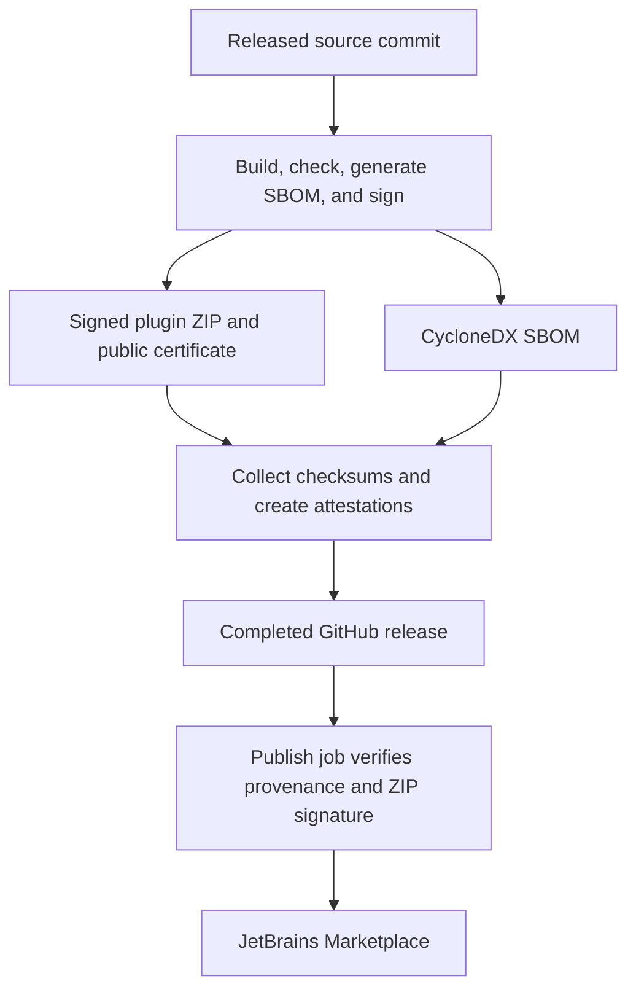

# Understanding release provenance, SBOMs, and attestations

When you install a plugin, you run software inside your IDE. A secrets-management plugin also
interacts with sensitive development data. Reviewing its source is useful, but you also need a
way to connect the downloaded binary to the project and release you intended to install.

This project publishes release evidence to help answer three questions:

- **Origin:** which repository, source revision, and workflow produced this file?
- **Contents:** which software components does the project's dependency inventory describe?
- **Integrity:** does my downloaded file match the file covered by that evidence?

These checks help detect substituted downloads and support dependency investigations. They work
alongside source review, tests, vulnerability scanning, and protection of the release process.

## 📖 The terms in plain language

| Term | Meaning | Example in this project |
| --- | --- | --- |
| Artifact | A file produced or distributed by a build. | The plugin ZIP or a JAR inside it. |
| Digest / checksum | A fingerprint calculated from a file's bytes. Changing those bytes changes the fingerprint with overwhelming probability. | SHA-256 entries in `SHA256SUMS`. |
| SBOM | A **Software Bill of Materials**: a machine-readable component inventory. Think of an ingredient list. | A CycloneDX `.cdx.json` file. |
| Provenance | Information about an artifact's origin and production process. Think of a build receipt. | The release's source commit and GitHub Actions workflow identity. |
| Attestation | A signed statement about a particular artifact, identified by its digest. | A provenance statement or an SBOM statement bound to the plugin ZIP. |
| Plugin signature | A signature checked against the plugin signing certificate. | The signed ZIP verified with `chain.crt`. |

## 🔢 Why a checksum alone is not enough

A checksum helps catch a corrupted download or a file that differs from a known reference. It
does not identify who supplied that reference.

For example, someone who can replace a ZIP on an untrusted download site could replace the
checksum beside it too. Both files would agree. You need an authenticated connection between
the file and a producer you trust.

This project publishes checksums for convenient integrity checks and also attests the checksum
file itself. Verification of the expected producer provides the additional origin check.

## 📋 What an SBOM tells you

An SBOM records components and their versions, and can describe identifiers, licenses, and
relationships between dependencies. Security tools can use this inventory when investigating
outdated packages or newly disclosed vulnerabilities. See the
[CycloneDX introduction to SBOMs](https://cyclonedx.org/capabilities/sbom/).

For example, suppose a hypothetical library version becomes vulnerable next month. An inventory
for an older release helps you investigate whether that release depended on it, even without
rebuilding the old version. You still need vulnerability information and an assessment of whether
the affected component and vulnerable behavior are relevant to your use.

This project generates a CycloneDX JSON SBOM with `./gradlew cyclonedxBom`. The
[Gradle configuration](build.gradle.kts) includes build-environment dependency information, so the
inventory can describe more than the JARs shipped inside the plugin ZIP. Do not interpret every
listed component as a bundled runtime dependency.

The SBOM is generated from dependency information. It is not a guarantee of a complete inventory
of your IDE, operating system, Doppler CLI, containers, or other software you run. Generating it
also does not itself establish that its components are free of vulnerabilities.

### Scan a published SBOM for vulnerabilities with Grype

[Grype](https://github.com/anchore/grype) scans an existing SBOM for known vulnerabilities.
It [accepts CycloneDX JSON](https://oss.anchore.com/docs/guides/vulnerability/scan-targets/), so
you can use this project's published `.cdx.json` directly. You do not need Syft or a plugin rebuild.

Install Grype using the [installation guide](https://oss.anchore.com/docs/installation/grype/).
For example, with Homebrew:

```bash
brew tap anchore/grype
brew install grype
```

Download the SBOM for the release you want to inspect and verify the release evidence using
the [README instructions](README.md#verify-a-github-release-download). Then run the following
from the directory containing that SBOM, replacing the example version with your downloaded file:

```bash
sbom="./doppler-plugin-1.7.0.cdx.json"
grype version
grype db update
grype "sbom:$sbom"
```

Grype downloads and caches a vulnerability database locally. The scan reads the SBOM; it does
not install or run the plugin. The table shows matched packages, installed versions, vulnerability
identifiers, severity, and available fixes. See
[how to interpret Grype results](https://oss.anchore.com/docs/guides/vulnerability/interpreting-results/).

To save a machine-readable report:

```bash
grype "sbom:$sbom" -o json --file grype-results.json
```

To make a script or CI check fail when a match has **High or Critical** severity:

```bash
grype "sbom:$sbom" --fail-on high
```

The [Grype CLI reference](https://oss.anchore.com/docs/reference/grype/cli/) documents exit code
`2` for this severity threshold. Other nonzero exits can indicate scan errors. Without
`--fail-on`, a successful scan can still report vulnerabilities; with `--fail-on high`, lower-severity
findings can still be present when the command succeeds.

Review matches before deciding whether a release is affected: check the package identity, version,
advisory, and whether the component is shipped or only used during the build. This project's SBOM
includes build-environment information. A match alone does not demonstrate an exploitable path,
and no matches does not prove the plugin is safe. Vulnerability scanning also does not verify the
SBOM's authenticity or its binding to the ZIP; use the attestation checks for that.

You can update the database and rescan the same SBOM later to investigate newly published advisories.

## 🏷️ What provenance tells you

Provenance connects an artifact to its production context. For this project, the verification
policy checks the repository, release workflow, source commit, and runner type associated with
an artifact. The [SLSA provenance model](https://slsa.dev/spec/v1.2/provenance) describes the concept
and its role in tracing software to its origin.

This helps distinguish a file associated with the intended release process from a similarly
named file built elsewhere. A filename such as `doppler-plugin-1.7.0-signed.zip` is easy to copy;
matching the expected signed statement and file digest supplies stronger evidence.

Provenance does not mean that the source was reviewed, that the build was reproducible, or that
every dependency has its own verified origin. The workflow and its inputs still need to be
trusted. This guide does not claim a particular SLSA certification or assurance level.

## 🛡️ What an attestation adds

An attestation binds a claim to an artifact digest and makes the statement verifiable. Its
**subject** identifies the artifact; its **predicate** contains the claim. These are two different
claims in this project's release process:

| Attestation | Subject | Claim |
| --- | --- | --- |
| Build provenance | Each released file and each extracted JAR. | The artifact is associated with the recorded release workflow and source revision. |
| SBOM | The original signed plugin ZIP. | This CycloneDX dependency inventory describes that ZIP. |

[GitHub artifact attestations](https://docs.github.com/en/actions/concepts/security/artifact-attestations)
use Sigstore and GitHub Actions' authenticated workflow identity. Verification checks the signed
statement and whether it applies to the file you have. The GitHub CLI retrieves the attestation
records; they do not need to be separate assets beside the downloaded ZIP.

A valid signature alone is insufficient: the statement also needs to come from the repository
and workflow you intended to trust. Anyone else's valid attestation is not evidence that a file
belongs to this project.

Attesting a JAR copied into the release does not establish its upstream library's source or
build process. It establishes that these exact JAR bytes were included in this project's
attestation process.

## ✍️ How the plugin signature differs

The plugin ZIP is also signed with the project's plugin signing key. The public certificate is
published as `chain.crt`; verification does not require the private key or its password.
[JetBrains documents ZIP signature verification](https://plugins.jetbrains.com/docs/intellij/plugin-signing.html#plugin-signature-verification).

The checks have different roles:

- **ZIP signature:** does the archive verify against the expected plugin certificate?
- **Provenance attestation:** does this exact file match the expected workflow and source identity?
- **SBOM attestation:** is this dependency inventory bound to this exact archive?

A certificate included with an arbitrary download is not an independent trust anchor. In this
project's verification flow, verify `chain.crt`'s provenance before using it to check the ZIP.
The plugin certificate is separate from the workflow identity used for GitHub attestations;
`gh attestation verify` does not use `chain.crt`.

## 📦 What this project publishes

The [Release workflow](.github/workflows/release-please.yaml) builds the released commit, runs
checks, generates the SBOM, and signs and verifies the plugin. A separate job receives the release
assets, extracts the packaged JARs, creates attestations, and publishes the completed release.



| Release asset | Purpose |
| --- | --- |
| `doppler-plugin-<version>-signed.zip` | The installable signed plugin archive. |
| `*.cdx.json` | The generated CycloneDX SBOM. |
| `chain.crt` | The public plugin signing certificate. |
| `SHA256SUMS` | SHA-256 checksums for the ZIP, SBOM, and certificate. |

All four files have provenance attestations. Every JAR extracted from the signed ZIP, including
bundled libraries, is also a provenance-attestation subject. Those extracted JARs are not
published as separate release assets. The additional SBOM attestation uses the signed ZIP as
its subject and the CycloneDX document as its predicate.

The [Publish workflow](.github/workflows/publish.yaml) verifies the ZIP and certificate's provenance
against the expected release workflow and tag commit, then verifies the ZIP signature. It sends
that existing archive to Marketplace without rebuilding or signing it again.

These statements describe the current workflow. Older releases may not contain all of this
evidence; check the assets and attestations for the version you are evaluating.

## 🔍 Why Marketplace verification checks JARs

Marketplace can modify the outer ZIP. Its bytes and checksum can therefore differ from the
original GitHub release even when its packaged JARs are unchanged.

This project attests the JARs individually so you can extract a Marketplace download and verify
each JAR's digest against the intended repository, release workflow, and commit.
Marketplace JAR attestation verification is supported starting with **version 1.7.0**; earlier
releases do not have the required JAR attestations.

**Successful JAR verification covers those JARs only.** It does not prove that non-JAR files or
ZIP metadata are unchanged, that no JAR was removed, or that the complete package has the same
contents as the original release. Establishing the complete file set requires comparison against
a trusted reference. The SBOM attestation remains bound to the original signed ZIP, not to a
Marketplace-modified ZIP.

## ✅ How to use the evidence

Start with the README's commands for your download:

- [Verify a GitHub release download](README.md#verify-a-github-release-download): download matching
  assets, check checksums, verify attestations, and verify the plugin signature.
- [Verify a Marketplace download](README.md#verify-a-marketplace-download): extract the JARs and
  verify every one against the intended release.

When verifying provenance, the [GitHub CLI options](https://cli.github.com/manual/gh_attestation_verify)
let you express the policy you intend to enforce:

| Option | Why it matters |
| --- | --- |
| `--repo` | Restricts the attestation to this repository. |
| `--signer-workflow` | Requires the expected Release workflow. |
| `--source-digest` | Pins the expected source commit; useful for binding verification to a specific release. |
| `--deny-self-hosted-runners` | Requires GitHub-hosted runner evidence for this workflow's policy. |
| `--predicate-type https://cyclonedx.org/bom` | Selects the SBOM claim instead of the default provenance claim. |

For a specific release, apply the repository, workflow, source-commit, and runner restrictions to
the attestation checks you rely on. Select the expected commit from the intended release in the
trusted repository; a valid attestation for a different version is not enough.

Read failures before installing. A failure can indicate different bytes, a mismatched version,
a policy mismatch, missing evidence for an older release, or an inability to retrieve evidence.
It is not by itself proof of an attack, but it also does not provide the verification you sought.

The benefit comes from checking the evidence and acting on the result. It can reveal a substituted
binary or help investigate a vulnerable dependency. A compromised source repository, malicious
release workflow, incomplete SBOM, or vulnerable but correctly attested dependency can still
produce authentic evidence. Use the evidence to inform trust and maintenance decisions; it does
not certify that the plugin is safe to run.
